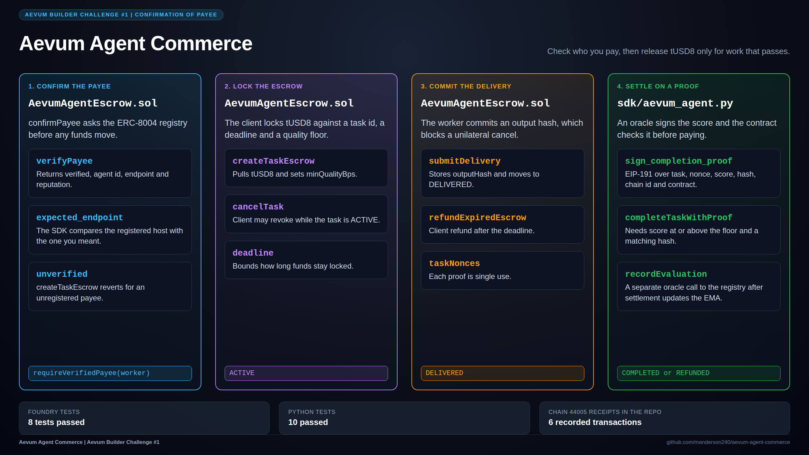
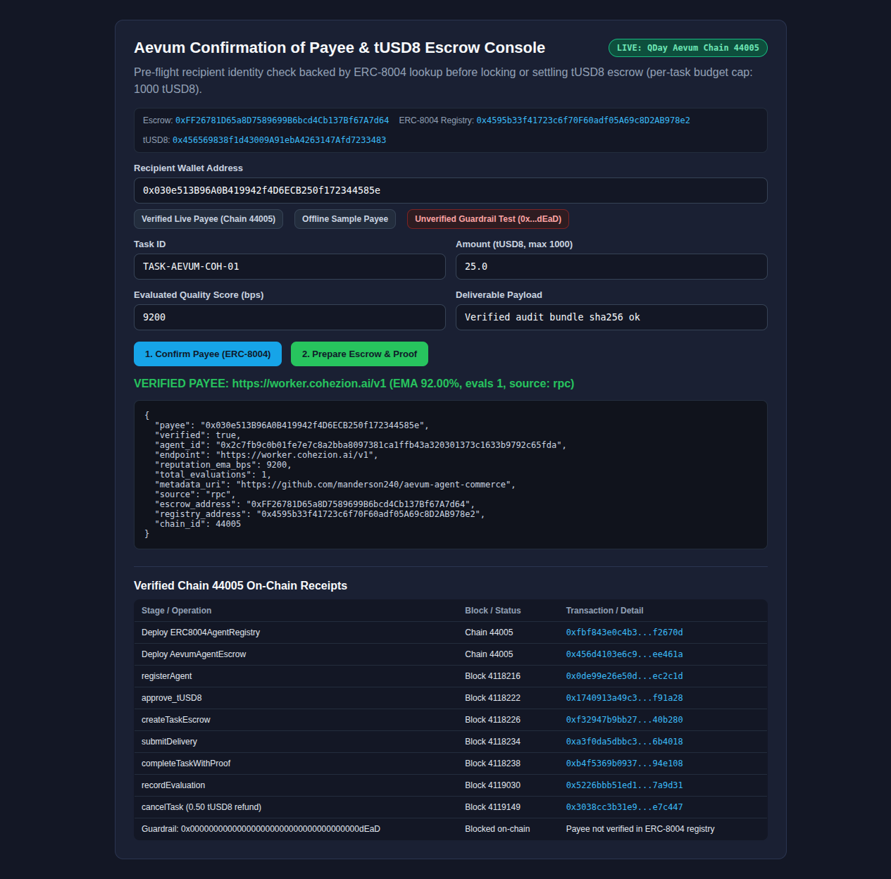

# DoraHacks BUIDL Submission: Aevum Agent Commerce

**Hackathon**: Aevum Builder Challenge #1 (Nov 16 to Dec 11, 2026)  
**Track**: Confirmation of Payee (Track ID 4748, paired with quality-gated `tUSD8` escrow settlement)  
**Repository**: https://github.com/manderson240/aevum-agent-commerce  

---

## Form fields

### Name
```text
Aevum Agent Commerce
```

### Brief description (117 characters)
```text
ERC-8004 Confirmation of Payee and quality-gated tUSD8 escrow with Solidity-parity Python signing and interactive UI.
```

### Tags
```text
DeFi, AI Agents, ERC-8004, Solidity, Foundry
```

### Team
```text
Mike Anderson
```

### Links
- GitHub: https://github.com/manderson240/aevum-agent-commerce
- Demo video: https://raw.githubusercontent.com/manderson240/aevum-agent-commerce/main/docs/aevum_commerce_demo.mp4
- Companion ERC-8004 Registry: https://github.com/manderson240/erc8004-agent-reputation

### Contact
- Telegram: `manderson240`
- Discord: `miked238725`

---

## Description

# Aevum Agent Commerce

### Why I built this
Autonomous agent and merchant `tUSD8` payments fail in two directions: sending stablecoins blindly to an unverified address invites typos and impersonation, while paying without delivery or quality checks breaks sender trust. I built Aevum Agent Commerce for the **Confirmation of Payee** track to combine pre-flight **ERC-8004 Confirmation of Payee** verification with quality-gated `tUSD8` escrow settlement on QDay Aevum Testnet (Chain `44005`).

### How it works
1. **Pre-flight ERC-8004 Confirmation of Payee (`confirmPayee` / `requireVerifiedPayee`)**: Before locking `tUSD8`, the sender and the Docker-packaged web console (`app/payee_ui.py` on port `8784`) query `confirmPayee(address)` and `verifyPayee(address)` on Chain `44005` (`0xFF26781D65a8D7589699B6bcd4Cb137Bf67A7d64` / `0x4595b33f41723c6f70F60adf05A69c8D2AB978e2`) to return verified status, `agentId`, HTTPS endpoint, EMA reputation (`9200` bps / `92.00%`), and evaluation count, reverting transactions to unverified recipients on-chain.
2. **Delivery commitment lock & revocation (`submitDelivery`, `cancelTask`, `refundExpiredEscrow`)**: Either party can revoke an `ACTIVE` task via `cancelTask` before delivery. Once the worker commits `outputHash` via `submitDelivery`, status moves to `DELIVERED`, blocking unilateral client cancellation while preserving client refunds after `deadline` via `refundExpiredEscrow`.
3. **Domain-separated oracle settlement (`completeTaskWithProof`) and EMA reputation (`recordEvaluation`)**: Releases locked `tUSD8` only when `qagScore >= minQualityBps`, `outputHash` matches, and an EIP-191 ECDSA signature over `keccak256(abi.encodePacked(taskId, nonce, qagScore, outputHash, block.chainid, address(this)))` recovers `verifierOracle`, and pays the worker. The EMA reputation update is a separate oracle transaction, `recordEvaluation` on the registry, sent after settlement by `scripts/run_live_aevum_settlement.py`.
4. **Solidity-parity Python SDK, Chunked Event Reader & Docker Console (`sdk/aevum_agent.py`, `app/payee_ui.py`, `Dockerfile`)**: Computes byte-identical `Web3.solidity_keccak` digests, enforces `<=1,000`-block `eth_getLogs` chunking (`fetch_recent_events_rpc`), adds 15s RPC timeouts with 3x retries, emits A2UI 1.0 escrow cards, and runs live against Chain `44005` in a single `docker run` container.

### Safety, trust and controls
On-chain `requireVerifiedPayee` blocks unverified wallets. `nonReentrant` guards state transitions. `block.chainid` and `address(this)` domain separation blocks cross-chain and cross-contract replay. `taskNonces` blocks duplicate-nonce replay. `deadline` bounds escrow lockup. UI inputs enforce EVM checksum checks and configurable per-task budget caps (`MAX_TASK_TUSD8`, default `1000.0 tUSD8`). DOM updates use `textContent` (zero `innerHTML`) to prevent script injection from untrusted on-chain metadata.

### Visual architecture and live console screenshot




### Live QDay Aevum Chain `44005` deployment and receipts
Because QDay Blockscout source verification is temporarily offline, exact deployed contract commits are linked directly below (full JSON receipts in `docs/aevum_testnet_deployment.json`):
- **Participant / Oracle / Registered Worker**: `0x030e513B96A0B419942f4D6ECB250f172344585e`
- **Live `ERC8004AgentRegistry`**: [`0x4595b33f41723c6f70F60adf05A69c8D2AB978e2`](https://explorer-test.qday.info/address/0x4595b33f41723c6f70F60adf05A69c8D2AB978e2) ([Source commit `86e2bc1`](https://github.com/manderson240/erc8004-agent-reputation/blob/86e2bc1f49b52a05000d1218b528381dcce5c873/src/ERC8004AgentRegistry.sol), CREATE Tx: [`0xfbf843e0...`](https://explorer-test.qday.info/tx/0xfbf843e0c4b3cb807872fabca096f8883bd3413d81dc193675af703163f2670d))
- **Live `AevumAgentEscrow`**: [`0xFF26781D65a8D7589699B6bcd4Cb137Bf67A7d64`](https://explorer-test.qday.info/address/0xFF26781D65a8D7589699B6bcd4Cb137Bf67A7d64) ([Source commit `b9bb2f8`](https://github.com/manderson240/aevum-agent-commerce/blob/b9bb2f8b45aef229fb688278f5bbe0a53f8faf6e/src/AevumAgentEscrow.sol), CREATE Tx: [`0x456d4103...`](https://explorer-test.qday.info/tx/0x456d4103e6c983dbcb3519dbd363428345fc0d8da48b3ca93fb135284eee461a), `setPayeeRegistry` Tx: [`0xe5c10a87...`](https://explorer-test.qday.info/tx/0xe5c10a87ddda1a661ab4f0df5899cfdd0c4224177ec9558cccce78c9993e5d51))
- **Live `TASK-AEVUM-LIVE-1795639978` (`1.0 tUSD8`) Settlement + Reputation EMA**: [registerAgent (`0x0de99e26...`)](https://explorer-test.qday.info/tx/0x0de99e26e50d436f849b026b6ba5555b9a2a7b0ab46cded74f986c5efeec2c1d), [approve tUSD8 (`0x1740913a...`)](https://explorer-test.qday.info/tx/0x1740913a49c3d394a0d0f527c364141c97fc18b8aba3f728b8731d19c6f91a28), [createTaskEscrow (`0xf32947b9...`)](https://explorer-test.qday.info/tx/0xf32947b9bb276efa42032c7b82a504975d34986c288823292acde0044440b280), [submitDelivery (`0xa3f0da5d...`)](https://explorer-test.qday.info/tx/0xa3f0da5dbbc39f1eb74c85085fc96601a9a7547b3d592a2c98937577056b4018), [completeTaskWithProof (`0xb4f5369b...`)](https://explorer-test.qday.info/tx/0xb4f5369b09372b263a2ef73475621ceb0b2479f6ef4c2771be6c113c9194e108), and [recordEvaluation `9200` bps (`0x5226bbb5...`, block `4119030`)](https://explorer-test.qday.info/tx/0x5226bbb51ed1a408021195f07b7070a795632a67b8b87a5418e75d786e7a9d31).
- **Live Revocation Control (`0.50 tUSD8` `cancelTask`)**: [approve (`0x2589d7cc...`)](https://explorer-test.qday.info/tx/0x2589d7cc40cd3add1fcf50996c1a5e635fddd27c687c658117a3018d303d785f), [createTaskEscrow (`0xa8223c63...`)](https://explorer-test.qday.info/tx/0xa8223c6312e46ac92fc864020a27c46d4ff58ec803b89bc6d40a079a1ff76423), [cancelTask (`0x3038cc3b...`)](https://explorer-test.qday.info/tx/0x3038cc3b31e9a238673b62ca60a8198d674086a4d542a04efe587ccbb4e7c447).
- **Live Unverified Payee Guardrail**: Calling `createTaskEscrow` targeting `0x000000000000000000000000000000000000dEaD` reverts on-chain with `"Payee not verified in ERC-8004 registry"`.

### Verification
- `forge build --force && python3 scripts/check_shanghai.py`: all `6` compiled runtime and creation bytecode blobs verified Shanghai-safe (`evm_version = "shanghai"`, zero Cancun opcodes).
- `forge test --no-match-path 'test/fork/*' -vv`: 8 of 8 Foundry tests pass (including 256 fuzz runs).
- `forge test --match-path 'test/fork/*' --fork-url aevum -vv`: 2 of 2 live QDay Aevum fork tests pass against real `tUSD8` (`0x456569838f1d43009A91ebA4263147Afd7233483`).
- `uv run pytest -q`: 10 of 10 tests pass (digest parity, ECDSA recovery, `<=1,000`-block chunking, XSS guard, budget cap, UI HTTP routes and expected endpoint matching).
- `uv run python scripts/e2e_anvil_demo.py`: Compiles and deploys contracts to a live local Shanghai Anvil EVM, runs `confirm_payee_rpc`, and settles `250.00 tUSD8` on-chain.
- `docker build -t aevum-agent-commerce . && docker run -p 8784:8784 aevum-agent-commerce`: Verified `/health`, live Chain `44005` `confirmPayee` (`reputation_ema_bps: 9200`, `total_evaluations: 1`), unverified address rejection (`0x...dEaD`), and `/api/activity` event decoding.
- Companion ERC-8004 Registry ([`manderson240/erc8004-agent-reputation`](https://github.com/manderson240/erc8004-agent-reputation)): Shanghai-safe bytecode verified (`2` blobs), and 9 of 9 Foundry tests pass there. Its own pytest suite also passes (4 passed).
- Walkthrough demo video (`147 s`, under 3 minutes, `2560x1440` H.264+AAC): [docs/aevum_commerce_demo.mp4](https://raw.githubusercontent.com/manderson240/aevum-agent-commerce/main/docs/aevum_commerce_demo.mp4).

### Limits
- Expected endpoint matching compares host names only. It does not prove who operates the host.
- Uses a self-deployed ERC-8004 registry while QDay's official registry remains in internal testing (`setPayeeRegistry` upgrades it in one call).
- Uses a single `verifierOracle` key today, and multi-oracle quorum contracts slot directly into `setVerifierOracle`.

### Future roadmap
- EIP-3009 `receiveWithAuthorization` (`tUSD8` v2) gasless escrow funding, official ERC-8004 singleton adapter, and Q1 2027 QDay mainnet rollout.

```bash
git clone https://github.com/manderson240/aevum-agent-commerce.git
cd aevum-agent-commerce
docker build -t aevum-agent-commerce . && docker run --rm -p 8784:8784 aevum-agent-commerce
```
