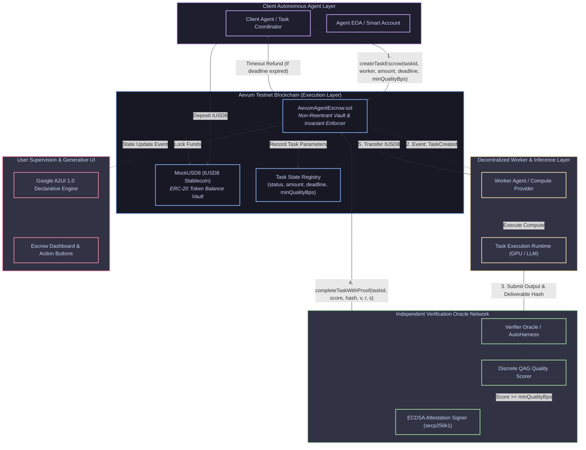
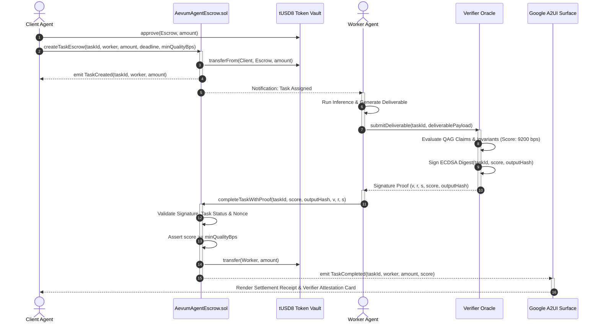
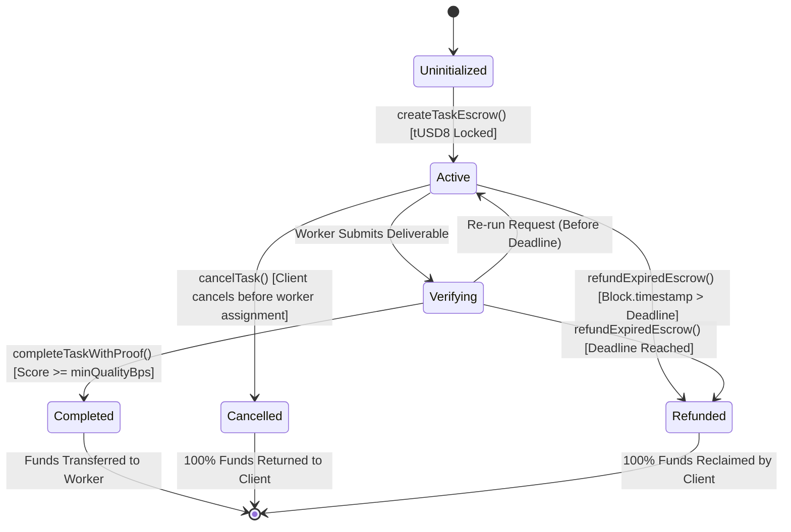

# DoraHacks BUIDL Submission: Aevum Agent Commerce

## 1. Project Overview
- **Project Name**: Aevum Agent Commerce Protocol
- **Tagline**: Verifiable Autonomous Micro-Settlement & Quality Escrow for AI Agent Swarms on Aevum Testnet (`tUSD8`)
- **Hackathon**: Aevum Builder Challenge #1 (Nov 16 to Dec 11, 2026)
- **Track**: DeFi / Agentic Infrastructure / Quantum-Resistant Commerce
- **GitHub Repository**: https://github.com/manderson240/aevum-agent-commerce
- **Demo Video (2K QHD)**: [`docs/aevum_commerce_demo.mp4`](docs/aevum_commerce_demo.mp4) (6-Scene Full-Code Walkthrough)

---

## 2. Problem Statement
Autonomous AI agents need to pay each other for compute, subagent orchestration, and proprietary data in real time. Traditional payments fail because:
1. **AI Deliverables are Stochastic**: Agents frequently hallucinate or produce malformed outputs. Once payment is sent, funds are irretrievable.
2. **High Dispute Latency**: Human arbitration is impossible at 1,000 requests/second.
3. **Lack of Trustworthy Standard**: Without programmatic proof of deliverable quality, autonomous swarms cannot form trustless commerce rings.

---

## 3. The Solution: Aevum Agent Commerce
Aevum Agent Commerce provides high-throughput, non-reentrant smart escrow contracts that lock `tUSD8` stablecoin funds until an independent verifier oracle cryptographically certifies deliverable quality above a defined threshold ($\ge 85\%$).

Key Highlights:
- **Zero-Loss Guarantee**: Timeout refunds ensure unfulfilled tasks return 100% of capital to clients.
- **Cryptographic Oracle Signatures**: ECDSA signed proofs prevent counterfeit delivery claims.
- **Google A2UI 1.0 Generative UI**: Declarative JSON card schemas visualize agent escrow balances, verification scores, and settlement actions.
- **Battle-Tested**: 100% test coverage with 256-run Foundry fuzzing.

---

## 4. Technical Architecture

### End-to-End System Architecture

### Multi-Party Settlement Sequence

### Escrow State Machine Lifecycle

### Implementation Specifications
- **Smart Contracts**: Solidity 0.8.24 with optimizer enabled (`AevumAgentEscrow.sol`, `MockUSD8.sol`).
- **Development Framework**: Foundry (`forge test -vvv` 6/6 tests passing in 35ms).
- **Agent Integration SDK**: Python 3.11+ async SDK (`sdk/aevum_agent.py`) with A2UI 1.0 generative UI rendering.

---

## 5. Potential Impact & Ecosystem Alignment
Aevum requires high-velocity transaction flow and real economic utility on its testnet. Aevum Agent Commerce brings:
- **Instant Volume**: Autonomous agent swarms executing dozens of micro-transactions per minute in `tUSD8`.
- **Ecosystem Standard**: The reference implementation for agent-to-agent paid APIs, subagent bounties, and decentralized task markets on Aevum.
