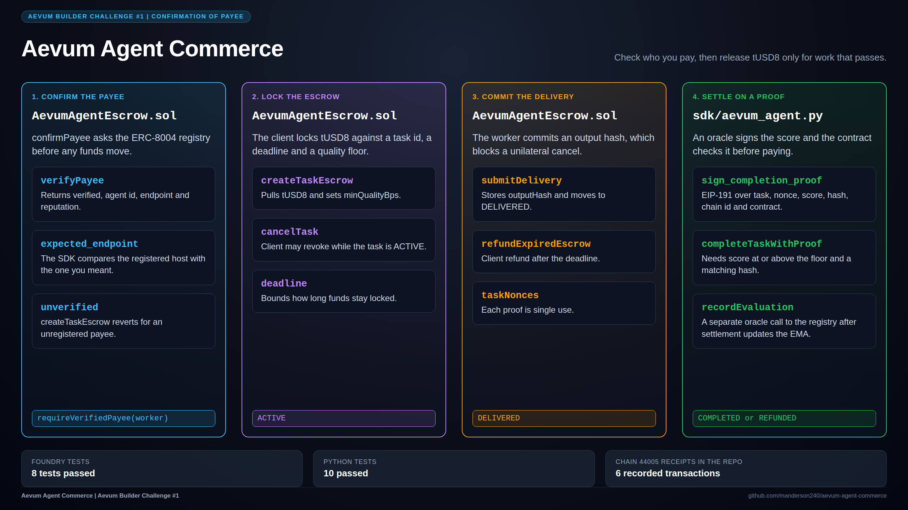
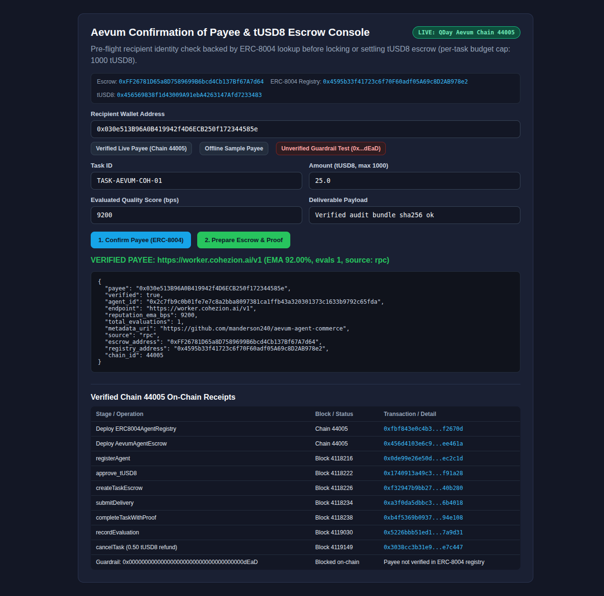
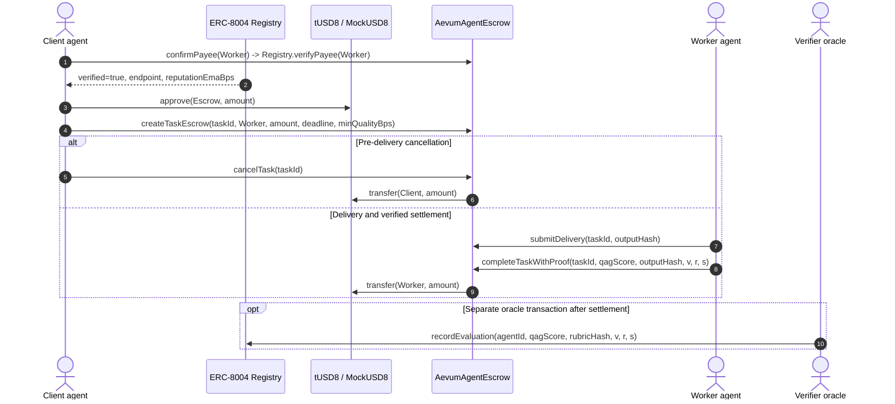

# Aevum Agent Commerce

A quality-gated `tUSD8` escrow contract paired with an ERC-8004 Confirmation of Payee registry, Solidity-parity Python SDK with EIP-191 oracle signing and 1,000-block chunked event indexing, Docker-packaged live console, and local Anvil verification built for Aevum Builder Challenge #1 (Confirmation of Payee track).



Demo video (147 s, 2560x1440): https://raw.githubusercontent.com/manderson240/aevum-agent-commerce/main/docs/aevum_commerce_demo.mp4

---

## Quickstart

### Option A: Packaged Docker Image (Live QDay Aevum Chain 44005 Mode)

```bash
git clone https://github.com/manderson240/aevum-agent-commerce.git
cd aevum-agent-commerce

docker build -t aevum-agent-commerce .
docker run --rm -p 8784:8784 aevum-agent-commerce
# Open http://127.0.0.1:8784 to verify payees live against Chain 44005 (no private key required)
```

### Option B: Local Foundry and Python verification

```bash
# Solidity unit tests (8/8 including 256 fuzz runs)
# Needs forge-std: forge install foundry-rs/forge-std --no-git
forge test --no-match-path 'test/fork/*' -vv

# Shanghai EVM bytecode safety check (required for QDay Aevum)
python3 scripts/check_shanghai.py

# Live QDay Aevum fork tests against real tUSD8 (Chain 44005, no faucet funds needed)
forge test --match-path 'test/fork/*' --fork-url aevum -vv

# Python SDK, Confirmation of Payee UI and guardrail tests (10/10)
uv sync --all-extras
uv run pytest -q

# Local Anvil end-to-end verification (Shanghai hardfork, real ERC-8004 lookup + ECDSA payout)
uv run python scripts/e2e_anvil_demo.py

# Interactive UI in Live Chain 44005 mode (or pass --offline for sample directory)
uv run python app/payee_ui.py
```

Output from a run of the test commands above:

```text
$ forge test --no-match-path 'test/fork/*'
Suite result: ok. 8 passed; 0 failed; 0 skipped
$ python3 scripts/check_shanghai.py
OK: 6 bytecode blobs verified Shanghai-safe.
$ forge test --match-path 'test/fork/*' --fork-url aevum
[PASS] test_ForkConfirmPayeeAndRealTusd8Settlement() (gas: 3487710)
[PASS] test_RealTusd8MetadataAndDomain() (gas: 43795)
Suite result: ok. 2 passed; 0 failed; 0 skipped
$ uv run pytest -q
10 passed in 1.91s
```



---

## How it works

### 1. Smart Contracts

- [`src/AevumAgentEscrow.sol`](src/AevumAgentEscrow.sol) (deployed commit: [`b9bb2f8b`](https://github.com/manderson240/aevum-agent-commerce/blob/b9bb2f8b45aef229fb688278f5bbe0a53f8faf6e/src/AevumAgentEscrow.sol))
- [`src/MockERC8004Registry.sol`](src/MockERC8004Registry.sol) / companion [`ERC8004AgentRegistry.sol`](https://github.com/manderson240/erc8004-agent-reputation/blob/86e2bc1f49b52a05000d1218b528381dcce5c873/src/ERC8004AgentRegistry.sol)

Task states follow `NONE -> ACTIVE -> DELIVERED -> COMPLETED` (or `REFUNDED`):

1. **Confirmation of Payee (`confirmPayee(address)` / `requireVerifiedPayee`)**: Queries `IERC8004PayeeRegistry.verifyPayee(worker)` before locking `tUSD8` escrow in `createTaskEscrow`, returning verified status, `agentId`, HTTPS endpoint, and EMA reputation score, or reverting on unverified recipients (`"Payee not verified in ERC-8004 registry"`).
2. **Delivery Commitment Lock (`submitDelivery(bytes32,bytes32)`)**: Moves the task to `DELIVERED` once the worker commits `outputHash`, blocking unilateral client `cancelTask` while keeping post-deadline `refundExpiredEscrow` available.
3. **Domain-Separated Oracle Settlement (`completeTaskWithProof`)**: Verifies EIP-191 `ecrecover` over `keccak256(abi.encodePacked(taskId, nonce, qagScore, outputHash, block.chainid, address(this)))` against `verifierOracle`, increments `taskNonces[taskId]`, checks `outputHash` equality if `DELIVERED`, enforces `qagScore >= minQualityBps`, and transfers locked `tUSD8`.
4. **Revocation & Timeout Refunds (`cancelTask`, `refundExpiredEscrow`)**: Lets either party revoke an `ACTIVE` escrow before delivery, or refunds expired unclaimed escrows to the client after `deadline`.



### 2. Python SDK, chunked event reader and console API

- [`sdk/aevum_agent.py`](sdk/aevum_agent.py):
  - `AevumAgentCommerce.confirm_payee_rpc(worker_address)` and `check_registry_details_rpc(payee_address)` query Chain `44005` contracts with explicit 15s HTTP timeouts and 3x backoff retries.
  - `fetch_recent_events_rpc(from_block, to_block)` splits `eth_getLogs` queries into `<=1,000`-block chunks (`AEVUM_MAX_LOG_RANGE = 1000`) to obey QDay Aevum RPC limits.
  - `compute_completion_digest(...)`, `sign_completion_proof(...)`, and `recover_completion_signer(...)` compute byte-identical EIP-191 proofs matching Solidity.
  - `generate_a2ui_escrow_card(task)` emits declarative A2UI 1.0 UI cards.
- [`app/payee_ui.py`](app/payee_ui.py): Interactive browser console and HTTP API on port `8784`:
  - `GET /`: Injection-safe Web console (zero `innerHTML`, uses DOM `textContent` and validated `https://explorer-test.qday.info/` links) with verified live Chain `44005` default lookup and unverified `0x...dEaD` guardrail preset.
  - `GET /health`: Returns active mode (`live` / `offline`), `chain_id`, contract addresses, and per-task budget cap (`MAX_TASK_TUSD8`, default `1000.0`).
  - `GET /api/activity`: Returns recorded Chain `44005` receipts plus live `fetch_recent_events_rpc` escrow events.
  - `POST /api/confirm-payee`: Validates EVM address format (`Web3.is_address`) and runs pre-flight Confirmation of Payee lookup.
  - `POST /api/prepare-escrow`: Enforces budget cap (`0 < amount_usd8 <= MAX_TASK_TUSD8`), score bounds (`0..10000`), and verified-payee gate before signing a completion proof.

---

## Live QDay Aevum Chain `44005` deployment and receipts

Aligned with [qday-io/aevum-starter-kit](https://github.com/qday-io/aevum-starter-kit) (`https://rpc-test.qday.info`, Chain ID `44005`, legacy Type-0 txs, `evm_version = "shanghai"`). Since QDay's Blockscout contract verifier is currently offline, the exact deployed contract source commits are linked below and recorded in [`docs/aevum_testnet_deployment.json`](docs/aevum_testnet_deployment.json):

- **Participant / Oracle / Registered Worker**: `0x030e513B96A0B419942f4D6ECB250f172344585e`
- **Live `tUSD8` Token**: [`0x456569838f1d43009A91ebA4263147Afd7233483`](https://explorer-test.qday.info/address/0x456569838f1d43009A91ebA4263147Afd7233483) (`6` decimals, EIP-2612 + EIP-3009)
- **Live `ERC8004AgentRegistry`**: [`0x4595b33f41723c6f70F60adf05A69c8D2AB978e2`](https://explorer-test.qday.info/address/0x4595b33f41723c6f70F60adf05A69c8D2AB978e2)
  - Source commit: [`src/ERC8004AgentRegistry.sol` @ `86e2bc1`](https://github.com/manderson240/erc8004-agent-reputation/blob/86e2bc1f49b52a05000d1218b528381dcce5c873/src/ERC8004AgentRegistry.sol)
  - CREATE Tx: [`0xfbf843e0c4b3cb807872fabca096f8883bd3413d81dc193675af703163f2670d`](https://explorer-test.qday.info/tx/0xfbf843e0c4b3cb807872fabca096f8883bd3413d81dc193675af703163f2670d)
- **Live `AevumAgentEscrow`**: [`0xFF26781D65a8D7589699B6bcd4Cb137Bf67A7d64`](https://explorer-test.qday.info/address/0xFF26781D65a8D7589699B6bcd4Cb137Bf67A7d64)
  - Source commit: [`src/AevumAgentEscrow.sol` @ `b9bb2f8`](https://github.com/manderson240/aevum-agent-commerce/blob/b9bb2f8b45aef229fb688278f5bbe0a53f8faf6e/src/AevumAgentEscrow.sol)
  - CREATE Tx: [`0x456d4103e6c983dbcb3519dbd363428345fc0d8da48b3ca93fb135284eee461a`](https://explorer-test.qday.info/tx/0x456d4103e6c983dbcb3519dbd363428345fc0d8da48b3ca93fb135284eee461a)
  - `setPayeeRegistry` Config Tx: [`0xe5c10a87ddda1a661ab4f0df5899cfdd0c4224177ec9558cccce78c9993e5d51`](https://explorer-test.qday.info/tx/0xe5c10a87ddda1a661ab4f0df5899cfdd0c4224177ec9558cccce78c9993e5d51)

### Executed transactions on Chain `44005`

1. **`registerAgent`** (block `4118216`): [`0x0de99e26e50d436f849b026b6ba5555b9a2a7b0ab46cded74f986c5efeec2c1d`](https://explorer-test.qday.info/tx/0x0de99e26e50d436f849b026b6ba5555b9a2a7b0ab46cded74f986c5efeec2c1d)
2. **`approve_tUSD8` (`1.0 tUSD8`)** (block `4118222`): [`0x1740913a49c3d394a0d0f527c364141c97fc18b8aba3f728b8731d19c6f91a28`](https://explorer-test.qday.info/tx/0x1740913a49c3d394a0d0f527c364141c97fc18b8aba3f728b8731d19c6f91a28)
3. **`createTaskEscrow` (`TASK-AEVUM-LIVE-1795639978`, `1.0 tUSD8`)** (block `4118226`): [`0xf32947b9bb276efa42032c7b82a504975d34986c288823292acde0044440b280`](https://explorer-test.qday.info/tx/0xf32947b9bb276efa42032c7b82a504975d34986c288823292acde0044440b280)
4. **`submitDelivery`** (block `4118234`): [`0xa3f0da5dbbc39f1eb74c85085fc96601a9a7547b3d592a2c98937577056b4018`](https://explorer-test.qday.info/tx/0xa3f0da5dbbc39f1eb74c85085fc96601a9a7547b3d592a2c98937577056b4018)
5. **`completeTaskWithProof` (`9200` bps QAG)** (block `4118238`): [`0xb4f5369b09372b263a2ef73475621ceb0b2479f6ef4c2771be6c113c9194e108`](https://explorer-test.qday.info/tx/0xb4f5369b09372b263a2ef73475621ceb0b2479f6ef4c2771be6c113c9194e108)
6. **`recordEvaluation` (separate oracle transaction, `9200` bps EMA -> `totalEvaluations = 1`)** (block `4119030`): [`0x5226bbb51ed1a408021195f07b7070a795632a67b8b87a5418e75d786e7a9d31`](https://explorer-test.qday.info/tx/0x5226bbb51ed1a408021195f07b7070a795632a67b8b87a5418e75d786e7a9d31)
7. **Revocation Demo (`TASK-AEVUM-CANCEL-LIVE-1795640916`, `0.50 tUSD8` `approve -> createTaskEscrow -> cancelTask`)**: [`0x2589d7cc...`](https://explorer-test.qday.info/tx/0x2589d7cc40cd3add1fcf50996c1a5e635fddd27c687c658117a3018d303d785f) (block `4119145`), [`0xa8223c63...`](https://explorer-test.qday.info/tx/0xa8223c6312e46ac92fc864020a27c46d4ff58ec803b89bc6d40a079a1ff76423) (block `4119147`), [`0x3038cc3b...`](https://explorer-test.qday.info/tx/0x3038cc3b31e9a238673b62ca60a8198d674086a4d542a04efe587ccbb4e7c447) (block `4119149`)
8. **Unverified Payee Guardrail Proof**: Live `eth_call` `createTaskEscrow` targeting `0x000000000000000000000000000000000000dEaD` reverts with `"Payee not verified in ERC-8004 registry"`.

---

## Configuration

| Variable | Default | Purpose |
|---|---|---|
| `AEVUM_UI_MODE` | `live` (in CLI `main()` and Docker, `offline` via `--offline`) | Switches between live Chain `44005` RPC lookups and local sample directory |
| `AEVUM_RPC_URL` | `https://rpc-test.qday.info` | QDay Aevum Testnet JSON-RPC endpoint (`44005`, legacy Type-0 txs) |
| `ESCROW_ADDRESS` | `0xFF26781D65a8D7589699B6bcd4Cb137Bf67A7d64` | Deployed `AevumAgentEscrow` address |
| `ERC8004_REGISTRY_ADDRESS` | `0x4595b33f41723c6f70F60adf05A69c8D2AB978e2` | Deployed `ERC8004AgentRegistry` address |
| `TUSD8_ADDRESS` | `0x456569838f1d43009A91ebA4263147Afd7233483` | `tUSD8` stablecoin (`6` decimals) |
| `MAX_TASK_TUSD8` | `1000.0` | Per-task escrow preparation budget cap in the console UI |
| `--keystore <name>` | `~/.foundry/keystores/aevum-deployer` | Encrypted Foundry keystore for `forge script` and `run_live_aevum_settlement.py` |

---

## Tests

```bash
forge test --no-match-path 'test/fork/*'   # 8 passed
uv run pytest -q                           # 10 passed
```

## Limits

- **Endpoint match is a host comparison**: `POST /api/confirm-payee` accepts an optional `expected_endpoint` and returns `endpoint_match` as `match`, `mismatch` or `unverified` by comparing host names with the registry record. It does not prove who runs that host. `tests/test_sdk.py` pins all three outcomes.

- **Self-deployed ERC-8004 Registry**: Per the Aevum Starter Kit, QDay's protocol ERC-8004 registry is still in internal testing, so this project runs against my live Chain `44005` `ERC8004AgentRegistry` and can swap registries in one call via `setPayeeRegistry(address, bool)`.
- **Single Verifier Oracle**: `completeTaskWithProof` checks one `verifierOracle` address. A production setup can point `setVerifierOracle` to a multi-sig or quorum verifier contract without changing escrow storage.
- **Merchant & Agent Distribution Plan**: Teams installing the Python package (`sdk/aevum_agent.py`) or running the Docker image (`app/payee_ui.py`) drop Confirmation of Payee checks directly in front of invoice payouts, contractor streams, and autonomous agent tasks with zero key custody on the read path.

---

## Future roadmap

- Add EIP-3009 `receiveWithAuthorization` funding (`name: "tUSD8"`, `version: "2"`) for gasless escrow deposits, wire QDay's official public ERC-8004 registry once open, and prepare Q1 2027 mainnet adapters.

---

## Hackathon deliverables

- Submission copy: [`BUIDL_SUBMISSION.md`](BUIDL_SUBMISSION.md)
- Logo: [`docs/aevum_agent_commerce_logo.png`](docs/aevum_agent_commerce_logo.png)
- Architecture diagram: [`docs/architecture_diagram.png`](docs/architecture_diagram.png)
- Live Console Screenshot: [`docs/payee_ui_screenshot.png`](docs/payee_ui_screenshot.png)
- Demo video (`147 s`, under 3 minutes): [`docs/aevum_commerce_demo.mp4`](docs/aevum_commerce_demo.mp4)
- Companion ERC-8004 Registry: [manderson240/erc8004-agent-reputation](https://github.com/manderson240/erc8004-agent-reputation)
- Third-party dependency licenses: [`NOTICE.md`](NOTICE.md)

## License

MIT (see [LICENSE](LICENSE) and [NOTICE.md](NOTICE.md))
