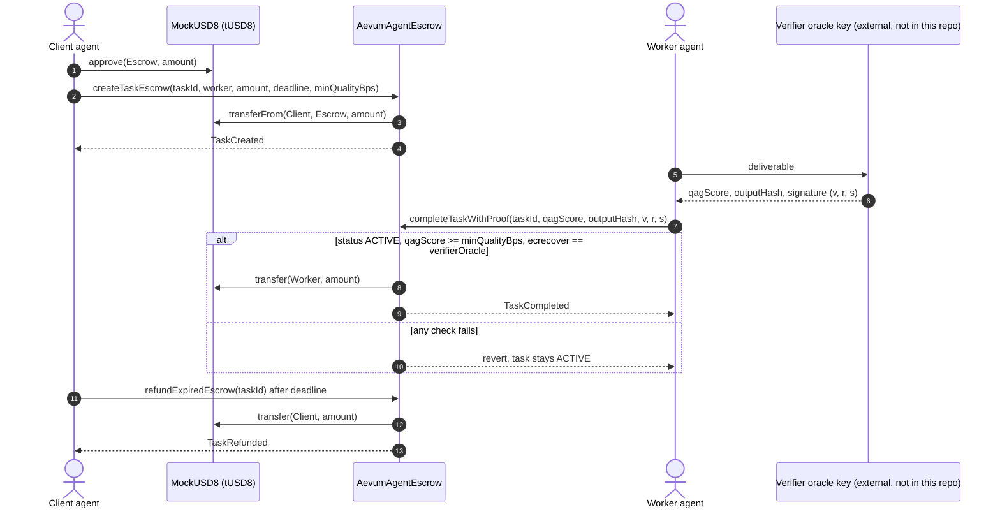
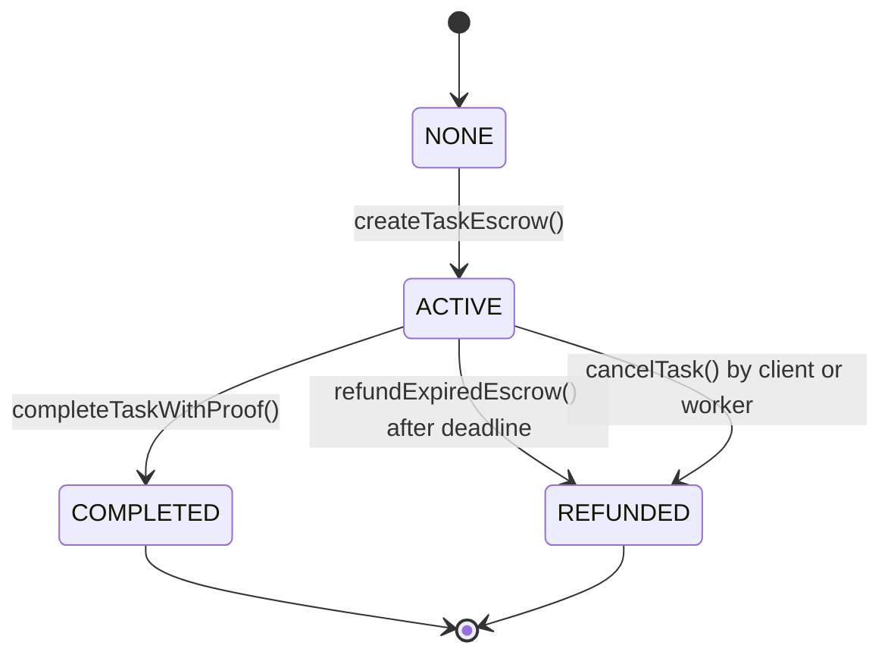

# Aevum Agent Commerce

A quality-gated escrow contract for agent-to-agent payments in `tUSD8`, plus a small Python helper, that I built for the Aevum Builder Challenge #1 (Nov 16 to Dec 11, 2026).

A client agent locks `tUSD8` in the escrow for a task. The worker agent is paid only when someone presents a quality score at or above the task's threshold together with a signature from the verifier oracle address set at deploy time. If that never happens, the client can take the funds back after the deadline.

---

## Quickstart

```bash
git clone https://github.com/manderson240/aevum-agent-commerce.git
cd aevum-agent-commerce

# Solidity tests (needs Foundry: https://book.getfoundry.sh)
forge test -vv

# Python tests
uv run pytest -q
```

### Python helper demo

The repo has no packaged CLI. This is the snippet I ran to exercise the Python helper:

```bash
uv run python -c '
from sdk.aevum_agent import AevumAgentCommerce
c = AevumAgentCommerce(escrow_address="0x1234567890123456789012345678901234567890")
for tid, score in [("TASK-PASS", 9200), ("TASK-LOW", 7400)]:
    t = c.create_task_order(tid, client="0xClient", worker="0xWorker00000000000000000000000000000002", amount_usd8=250.0, min_quality_bps=8500)
    r = c.verify_and_settle_task(t, deliverable_content="agent output for " + tid, qag_score_bps=score)
    print(tid, "score", score, "passed", r["passed"], "status", t.status, "hash", r["output_hash"][:18])
    print("  card", r["a2ui_card"]["props"]["title"], "|", r["a2ui_card"]["children"][1]["props"]["label"])
'
```

Output:

```text
TASK-PASS score 9200 passed True status COMPLETED hash 0xfd339469b6aec2b0
  card Aevum Autonomous Agent Escrow: TASK-PASS | Quality Score: 92.0%
TASK-LOW score 7400 passed False status REJECTED_QUALITY hash 0x72703694f4218467
  card Aevum Autonomous Agent Escrow: TASK-LOW | Quality Score: 74.0%
```

This runs entirely in memory. It does not talk to a chain (see Limits).

---

## How it works

### The contract: [`src/AevumAgentEscrow.sol`](src/AevumAgentEscrow.sol)

Each task is a `TaskEscrow` struct keyed by a `bytes32 taskId`, with a status from `TaskStatus { NONE, ACTIVE, COMPLETED, REFUNDED }`. The constructor takes the payment token address and the verifier oracle address. All four external functions use a simple `nonReentrant` lock.

1. `createTaskEscrow(taskId, worker, amount, deadline, minQualityBps)` requires a new task ID, a non-zero worker, `amount > 0`, a deadline in the future and `minQualityBps <= 10000`. It records the task as ACTIVE and pulls `amount` from the caller with `transferFrom`.
2. `completeTaskWithProof(taskId, qagScore, outputHash, v, r, s)` requires the task to be ACTIVE and `qagScore >= minQualityBps`. It rebuilds the digest `keccak256(taskId, qagScore, outputHash, address(this))`, wraps it with the `\x19Ethereum Signed Message:\n32` prefix (EIP-191), and checks that `ecrecover` returns `verifierOracle`. On success it sets the task to COMPLETED, stores the score and output hash, and transfers `amount` to the worker. Anyone may submit the call; the payout always goes to the recorded worker.
3. `refundExpiredEscrow(taskId)` requires an ACTIVE task and `block.timestamp >= deadline`. It sets REFUNDED and returns `amount` to the client.
4. `cancelTask(taskId)` lets the client or the worker cancel an ACTIVE task. It sets REFUNDED and returns `amount` to the client.

Because every exit requires ACTIVE and moves the task out of ACTIVE before the transfer, a task can pay out or refund at most once.

### The token: [`src/MockUSD8.sol`](src/MockUSD8.sol)

A minimal 6-decimal ERC-20 named `tUSD8` that stands in for Aevum's testnet stablecoin in tests. It mints 1,000,000 tokens to the deployer, and its `mint` function is open to anyone.

### The Python helper: [`sdk/aevum_agent.py`](sdk/aevum_agent.py)

- `CommerceTask` is a dataclass holding the task fields plus `status`, `evaluated_score` and `proof_hash`.
- `AevumAgentCommerce.create_task_order` builds a `CommerceTask` with `status="ACTIVE"` and a deadline of now plus `duration_seconds` (default 3600).
- `verify_and_settle_task` raises `ValueError` if the task is not ACTIVE. Otherwise it SHA-256 hashes the deliverable, compares the given score with `min_quality_bps`, and sets the status to `COMPLETED` or `REJECTED_QUALITY`.
- `generate_a2ui_escrow_card` returns a JSON dict shaped like a Google A2UI card (`Card`, `MetricGrid`, `ProgressBar`, `ActionButtons`) describing the task and the two contract calls a UI could offer.

### Settlement sequence



### Task states



---

## Configuration

The code reads no environment variables. The contract takes two constructor arguments (token address, oracle address). The Python helper takes an `escrow_address` and an optional `rpc_url`, which defaults to `https://rpc-testnet.aevum.network` (the same URL is in `foundry.toml` as `aevum_testnet`). The helper stores `rpc_url` but does not use it.

---

## Tests

On my machine, this run (trimmed: the compile line and the final summary line removed):

```text
$ forge test -vv
Ran 6 tests for test/AevumAgentEscrow.t.sol:AevumAgentEscrowTest
[PASS] testFuzz_EscrowSettlement(uint256,uint256) (runs: 256, μ: 325450, ~: 309799)
[PASS] test_CompleteTaskWithValidProof() (gas: 377072)
[PASS] test_CreateTaskEscrow() (gas: 246689)
[PASS] test_RefundExpiredEscrow() (gas: 366605)
[PASS] test_RevertOnInvalidSignature() (gas: 270180)
[PASS] test_RevertOnSubparQuality() (gas: 268598)
Suite result: ok. 6 passed; 0 failed; 0 skipped; finished in 13.47ms (16.44ms CPU time)

$ uv run pytest -q
3 passed in 0.01s
```

What they cover:

- [`test/AevumAgentEscrow.t.sol`](test/AevumAgentEscrow.t.sol) (Foundry 1.9.0): creating an escrow and reading it back; paying out on a valid signature with score 9200 against threshold 8500; reverting on score 7400; reverting on a signature from the wrong key; refusing a refund before the deadline and allowing it after; and a fuzz test (256 runs) over amount (1 to 1,000 tUSD8) and score (0 to 10000) that checks the worker receives exactly `amount` when the score meets 8500 and that the call reverts otherwise. The oracle in these tests is a fixed test key signed with `vm.sign`.
- [`tests/test_sdk.py`](tests/test_sdk.py): the Python helper's pass path, its low-score path, and that a non-ACTIVE task cannot be settled.

`cancelTask` has no test.

---

## Limits

- Nothing in this repo is deployed. There is no contract address, `script/` is empty, and I have not run the deploy command below against the Aevum testnet RPC.
- There is no oracle or scoring service here. The "quality score" is whatever number the oracle key signs. In the tests that key is a hard-coded test key.
- The Python helper does not touch a chain and does not sign anything. Its `private_oracle_key` argument is unused, and its `REJECTED_QUALITY` status has no on-chain counterpart (the contract reverts and the task stays ACTIVE).
- The signed digest has no nonce and no chain ID. Replay on the same contract is blocked only because the task leaves ACTIVE. The contract address is in the digest, so a signature cannot be reused on a different escrow contract.
- Either party can call `cancelTask` alone while the task is ACTIVE. That means a client can cancel after the worker has delivered but before the proof is submitted.
- `completeTaskWithProof` does not check the deadline, so a valid proof can still settle after the deadline if no one has refunded yet.
- The signature is ECDSA over secp256k1, which is not post-quantum.
- There are no invariant tests; the fuzz test checks single settlements against a fixed threshold.
- `MockUSD8.mint` has no access control. It is a test token only.

---

## Deploying (untested)

```bash
forge create --rpc-url "$AEVUM_RPC_URL" \
  --private-key "$PRIVATE_KEY" \
  src/AevumAgentEscrow.sol:AevumAgentEscrow \
  --constructor-args "$TUSD8_ADDRESS" "$ORACLE_ADDRESS"
```

These are shell variables for `forge create`, not settings the code reads.

---

## Hackathon deliverables

- Submission form text: [`BUIDL_SUBMISSION.md`](BUIDL_SUBMISSION.md)
- Demo video: [`docs/aevum_commerce_demo.mp4`](docs/aevum_commerce_demo.mp4), generated with `python3 scripts/generate_pitch_video.py`

## License

MIT
