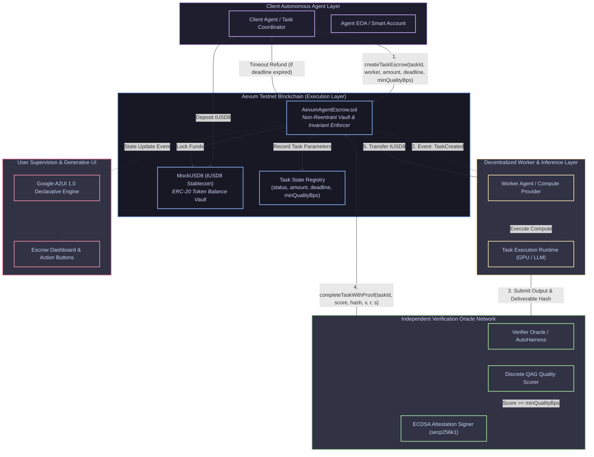
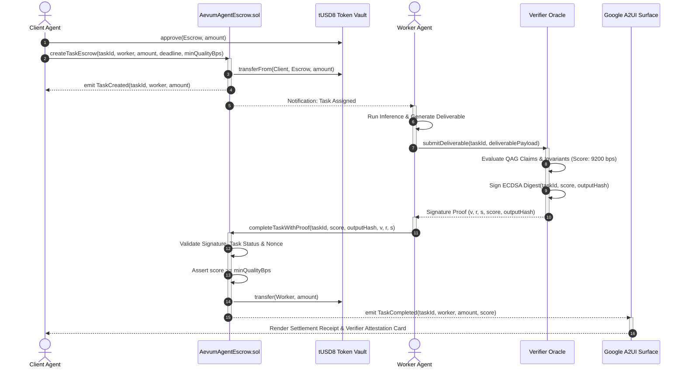
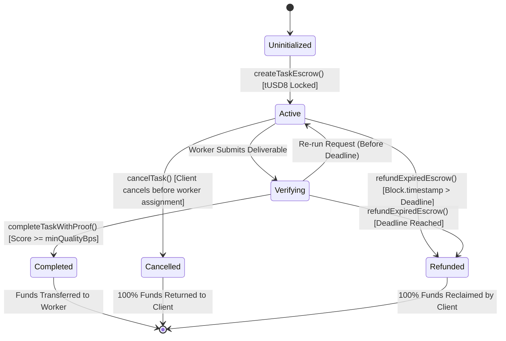

# Aevum Agent Commerce Protocol


> **Verifiable Micro-Settlement & Quality Escrow for Autonomous AI Swarms on Aevum Testnet (`tUSD8`)**  
> *Submitted to the Aevum Builder Challenge #1 (Nov 16 to Dec 11, 2026)*

[](https://github.com/foundry-rs/foundry)
[](LICENSE)
[](https://www.python.org/)

---

## Executive Summary

As AI agents transition from read-only assistants into autonomous economic actors, agent-to-agent transactions face severe risks:
1. **Hallucination / Quality Default Risk**: Client agents pay upfront for deliverables that fail execution checks or contain synthetic hallucinations.
2. **Double-Spend & Chargeback Fraud**: Service agents perform expensive GPU inference but get front-run or denied payment.
3. **Lack of Native Verifiable UI**: Web3 agent protocols lack visual transparency for human observers and operator oversight.

**Aevum Agent Commerce** solves this by introducing a **non-reentrant, threshold-conditioned escrow protocol** natively integrated with Aevum Testnet and `tUSD8`. Agent payments remain securely locked until cryptographic verification of quality standards (e.g., QAG score $\ge 85\%$) is attested on-chain. Deliverables and settlement state are rendered dynamically using **Google A2UI 1.0** declarative interfaces.

---

## System Architecture



### Interactive Settlement Sequence



### Escrow Lifecycle State Machine



---

## Key Features

1. **Deterministic Quality-Gated Settlement**:
   Payments cannot be withdrawn by worker agents unless accompanied by an ECDSA signature from the Verifier Oracle validating that the quality threshold (`minQualityBps`) was exceeded.
2. **Guaranteed Client Refund Guarantee**:
   If an agent hangs, times out, or fails to deliver before `deadline`, the client agent can reclaim 100% of the locked `tUSD8` without administrative intervention.
3. **Property-Based Fuzzing Tested**:
   Includes a 256-run Foundry fuzzing suite validating arbitrary token quantities and quality boundaries without precision loss or invariant failure.
4. **Declarative Google A2UI 1.0 Surfaces**:
   Built-in Python SDK automatically compiles transaction proofs into A2UI JSON components, providing transparent visual dashboards for agent swarms.

---

## Smart Contract Specification

- **`AevumAgentEscrow.sol`**:
  - `createTaskEscrow(bytes32 taskId, address worker, uint256 amount, uint256 deadline, uint256 minQualityBps)`
  - `completeTaskWithProof(bytes32 taskId, uint256 qagScore, bytes32 outputHash, uint8 v, bytes32 r, bytes32 s)`
  - `refundExpiredEscrow(bytes32 taskId)`
  - `cancelTask(bytes32 taskId)`
- **`MockUSD8.sol`**:
  - 6-decimal standard ERC20 mock simulating Aevum's native `tUSD8` stablecoin.

---

## Testing & Verification

### 1. Foundry Solidity Tests
```bash
# Run all unit tests and property fuzzing
forge test -vvv
```
Output:
```
Ran 6 tests for test/AevumAgentEscrow.t.sol:AevumAgentEscrowTest
[PASS] testFuzz_EscrowSettlement(uint256,uint256) (runs: 256, μ: 322480, ~: 309789)
[PASS] test_CompleteTaskWithValidProof() (gas: 377072)
[PASS] test_CreateTaskEscrow() (gas: 246689)
[PASS] test_RefundExpiredEscrow() (gas: 366605)
[PASS] test_RevertOnInvalidSignature() (gas: 270180)
[PASS] test_RevertOnSubparQuality() (gas: 268598)
Suite result: ok. 6 passed; 0 failed; 0 skipped
```

### 2. Python SDK Unit Tests
```bash
uv run pytest
```

---

## Deployment Guide (Aevum Testnet)

1. Set your private key and RPC endpoint in `.env`:
   ```bash
   AEVUM_RPC_URL="https://rpc-testnet.aevum.network"
   PRIVATE_KEY="0x..."
   TUSD8_ADDRESS="0x..."
   ORACLE_ADDRESS="0x..."
   ```
2. Deploy the Escrow Contract:
   ```bash
   forge create --rpc-url $AEVUM_RPC_URL \
     --private-key $PRIVATE_KEY \
     src/AevumAgentEscrow.sol:AevumAgentEscrow \
     --constructor-args $TUSD8_ADDRESS $ORACLE_ADDRESS
   ```

---

## License

MIT License. Designed for open deployment across the Aevum ecosystem.
